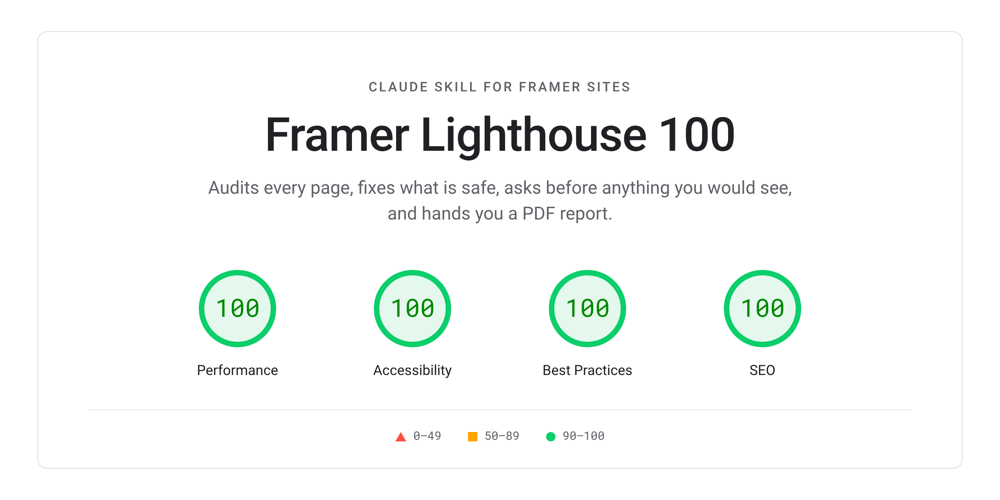
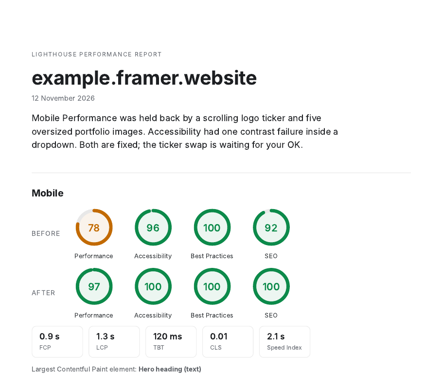

<p align="center">
  
</p>

<p align="center">
  <a href="#install">Install</a> ·
  <a href="#tips-and-example-requests">Tips</a> ·
  <a href="#how-it-works">How it works</a> ·
  <a href="SKILL.md">SKILL.md</a> ·
  <a href="https://github.com/studiohans-agency/framer-lighthouse-100/releases/latest">Latest release</a> ·
  <a href="CHANGELOG.md">Changelog</a>
</p>

# Framer Lighthouse 100

A Claude skill that audits a website built in Framer and works toward **100 / 100 / 100 / 100** in Google PageSpeed Insights (Performance, Accessibility, Best Practices, SEO) on **mobile and desktop**. It fixes what is safe on its own, asks before anything you would notice, and gives you a detailed report in the chat plus a PDF.

Made by [Studio Hans](https://studiohans.agency), a Framer studio in Hamburg.

## What it does

1. **Measures properly.** Runs PageSpeed 3 times per device through the API, and also in your own browser on pagespeed.web.dev. Opens your live site, scrolls every page to the bottom, and reads the console and network logs.
2. **Finds what PageSpeed misses.** Checks every image (including cards and sliders far down the page that PageSpeed never flags), every video, ticker, font, blur, embed and script. Checks contrast using the colors your browser actually paints, and finds empty states and missing meta descriptions on every page, CMS template, 404 page, legal page and locale.
3. **Fixes what is safe**, without asking: alt text, heading tags, landmarks, button, link and form labels, image Resolution set to Auto, oversized images resized, images as WebP, videos compressed to WebM, GIF to video, deferred scripts, nested links, titles and meta descriptions, site language, favicon.
4. **Asks before anything you would notice**: fonts, colors, animations, tickers, breakpoints, embeds, scripts and existing copy. It sends one numbered list ("reply 1 yes, 2 no"), applies what you approve, and keeps going until every item is decided.
5. **Verifies.** Re-reads every change in Framer, checks the resolved values in the browser after you publish, and reruns PageSpeed.
6. **Reports in full, twice.** A detailed report in the chat: what is wrong and where, what it changed with before and after values, what it will change next, what it suggests, and what Framer controls. Plus a **PDF** of the same report, ready to download and share.

It never publishes your site unless you tell it to.

<p align="center">
  
  <br><sub>The first page of the PDF report (example data)</sub>
</p>

### Things it catches that a PageSpeed score alone doesn't

* Five portfolio card images of several megabytes each, below the fold, never flagged by PageSpeed.
* A contrast failure that survived a color fix, because the color the browser painted came from a different layer than the one that was changed. The skill inspects the exact nodes and their resolved colors instead of assuming.
* A logo ticker that keeps phones busy on every frame. It suggests swapping it for a looping video of the same ticker, and can make that video for you.
* A hero video that keeps the mobile Speed Index high even though the page loads fast.
* Fonts that are not WOFF2, weights used once, and fallback fonts painting real text.
* Missing meta descriptions on CMS articles, the 404 page and legal pages.

## Results

Real client site (a premium car detailing business, built in Framer), PageSpeed Insights, median of 3 runs:

| | Performance | Accessibility | Best Practices | SEO |
|---|---|---|---|---|
| Mobile before | 75 | 100 | 100 | 100 |
| Mobile after | **100** | **100** | **100** | **100** |
| Desktop before | 88 | 100 | 100 | 100 |
| Desktop after | **100** | **100** | **100** | **100** |

The two fixes that mattered most:

* **Images and video:** WebP for images Framer couldn't optimize itself, a lighter mobile video, and loading the video only after the first scroll.
* **The desktop breakpoint:** PageSpeed tests desktop at 1350px wide. The site's desktop layout started at 1440px, so the test was scoring the tablet layout, where Framer rebuilds the hero after its code loads. Moving the desktop breakpoint to 1200px took desktop from 92 to 100.

Second real client site (a luxury villa in Croatia, German and English, built in Framer), single PageSpeed runs in the browser:

| | Performance | Accessibility | Best Practices | SEO |
|---|---|---|---|---|
| Mobile before | 73 | 92 | 100 | 100 |
| Mobile after | **100** | **100** | **100** | **100** |
| Desktop before | 99 | 91 | 100 | 100 |
| Desktop after | **100** | **100** | **100** | **100** |

What it took:

* **Changing the LCP element, not only the file sizes.** Cutting the home page from 12.6 MB to 2.2 MB (WebM hero video, every image resized) moved mobile only from 73 to 76. A phone only hero with the heading first, no animation, and the video in a block under it took mobile to 98 to 100.
* **A deferred video component** that loads the drone loop on the first touch or scroll, showing a brand colored panel until then.
* **Accessibility:** `aria-valuenow` on a custom before/after slider, a slightly darker grey on sand backgrounds, and a word by word text reveal that now starts invisible instead of faint.

## Install

### Option A: let Claude install it (Claude Code)

Paste this into Claude Code:

```text
Install the Claude skill from https://github.com/studiohans-agency/framer-lighthouse-100.
Clone it into ~/.claude/skills/framer-lighthouse-100, or pull the latest version if that folder
already exists. Then confirm that SKILL.md is in the folder.
```

Restart Claude Code so it loads the skill.

### Option B: install it yourself (Claude Code)

```bash
git clone https://github.com/studiohans-agency/framer-lighthouse-100.git ~/.claude/skills/framer-lighthouse-100
```

Or download `framer-lighthouse-100-v*.zip` from the [latest release](https://github.com/studiohans-agency/framer-lighthouse-100/releases/latest) and unzip it:

```bash
unzip framer-lighthouse-100-v*.zip -d ~/.claude/skills/
```

To update later: `git -C ~/.claude/skills/framer-lighthouse-100 pull`

### Option C: Claude app (claude.ai, desktop and mobile)

1. Download `framer-lighthouse-100-v*.zip` from the [latest release](https://github.com/studiohans-agency/framer-lighthouse-100/releases/latest).
2. In Claude, open **Settings → Capabilities → Skills** and upload the zip.
3. Make sure code execution is turned on, since the skill runs small scripts.

### What you need

**No npm package and no build step.** The skill is a folder of instructions and small scripts that Claude runs itself. Nothing is installed into your project, and nothing is added to your Framer site.

| | Needed? | What for |
|---|---|---|
| Claude with code execution | Required | Running the skill and its scripts |
| A connection to your Framer project (Framer MCP server or Framer plugin) | Recommended | Making the fixes. Without it, the skill measures and gives you step by step instructions instead |
| A browser tool: Claude in Chrome or the Claude desktop app's browser | Recommended | PageSpeed in your browser, the full page audit, console and network logs |
| Python 3 | Required for the scripts | `psi_summary.py`, `report.py` |
| Playwright, Chrome or WeasyPrint | For the PDF | `report.py` uses whichever is installed |
| `ffmpeg` | For video fixes | Converting videos to WebM |
| `cwebp` or `sharp` | For image fixes | Converting images Framer doesn't optimize to WebP |
| A free Google PageSpeed API key | Optional | Avoids the shared daily quota. Set `PSI_KEY` |

## Tips and example requests

* You don't have to name the skill. Asking about PageSpeed, Lighthouse, site speed or accessibility on a Framer site triggers it.
* Give it the live URL. With the Framer project connected too, it can fix things directly.
* Answer its questions with the numbers, for example "1 yes, 2 no, 3 yes". It keeps going until every item is decided.
* It never publishes. Publish yourself when you're happy, then ask it to verify.

Example requests:

```text
Use the framer-lighthouse-100 skill on https://yoursite.com
```

```text
My Framer site scores 74 on mobile in PageSpeed. Get it to 100 without changing the design.
```

```text
Audit every page of https://yoursite.com for accessibility and SEO, and send me the PDF report.
```

```text
Check why my desktop score is stuck at 90 while mobile is 100.
```

## How it works

| Pass | What happens |
|---|---|
| 1. Measure | PageSpeed through the API and in your browser, 3 runs each. A full page browser audit of every page. Console and network logs. An inventory of the Framer project: breakpoints, images, videos, tickers, fonts, code, SEO settings |
| 2. Fix | Performance, Accessibility, Best Practices and SEO, in that order. Every change is read back to confirm it landed, including tablet and phone overrides |
| 3. Ask | One numbered list of everything that changes the look or behavior, repeated until every item has a yes or a no |
| 4. Verify | After you publish: PageSpeed again, the browser audit again, and the real painted values of every change |
| 5. Report | A detailed report in the chat and a PDF to download |

Each finding goes into one of three buckets:

| Bucket | Meaning |
|---|---|
| ✅ Fix now | Invisible to visitors, can't hurt the design |
| ❓ Ask first | Changes how the site looks, reads or behaves |
| 🚫 Can't fix | Controlled by Framer's platform, explained in the report |

## What's in the folder

| File | Purpose |
|---|---|
| [`SKILL.md`](SKILL.md) | The instructions Claude follows |
| [`scripts/psi.sh`](scripts/psi.sh) | PageSpeed API runs, 3 per device |
| [`scripts/psi_summary.py`](scripts/psi_summary.py) | Medians, failing audits, every media and font request |
| [`scripts/browser_audit.js`](scripts/browser_audit.js) | Full page audit in the browser: images, video, tickers, fonts, meta, empty states, painted contrast, logs |
| [`scripts/psi_browser.js`](scripts/psi_browser.js) | Reads a finished pagespeed.web.dev report in the browser when the API is blocked or out of quota |
| [`scripts/report.py`](scripts/report.py) | Builds the PDF report |
| [`components/DeferredVideo.tsx`](components/DeferredVideo.tsx) | Framer code component: hero video that loads on first interaction, keeping it out of PageSpeed's test |
| [`examples/report_example.json`](examples/report_example.json) | Example input for the PDF |

## Contributing

Ideas, fixes and audit results from your own Framer sites are very welcome.

* **Found a gap?** Open an [issue](https://github.com/studiohans-agency/framer-lighthouse-100/issues/new/choose) with the URL, the scores and the audit that wouldn't clear.
* **Share a result.** Before and after scores help everyone see what works.
* **Improve the skill.** Read [CONTRIBUTING.md](CONTRIBUTING.md) first.

Please follow the [Code of Conduct](CODE_OF_CONDUCT.md). For security issues, see [SECURITY.md](SECURITY.md).

## References

* Framer Help: [Site optimization](https://www.framer.com/help/articles/site-optimization/)
* Framer Help: [Guide to Lighthouse scores](https://www.framer.com/help/articles/guide-to-lighthouse-scores/)
* Framer blog: [Lighthouse 13.6](https://www.framer.com/blog/lighthouse-13-6/)
* Google: [PageSpeed Insights](https://pagespeed.web.dev/) and the [PageSpeed Insights API](https://developers.google.com/speed/docs/insights/v5/get-started)
* [Claude skills](https://platform.claude.com/docs/en/agents-and-tools/agent-skills/overview)

## License

[MIT](LICENSE). Use it, change it and share it. Keep the copyright notice.

"Framer" is a trademark of Framer B.V. This project is independent and not affiliated with or endorsed by Framer or Google.
